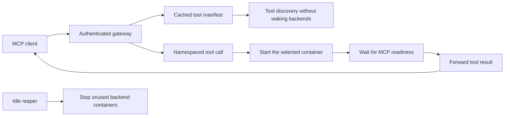
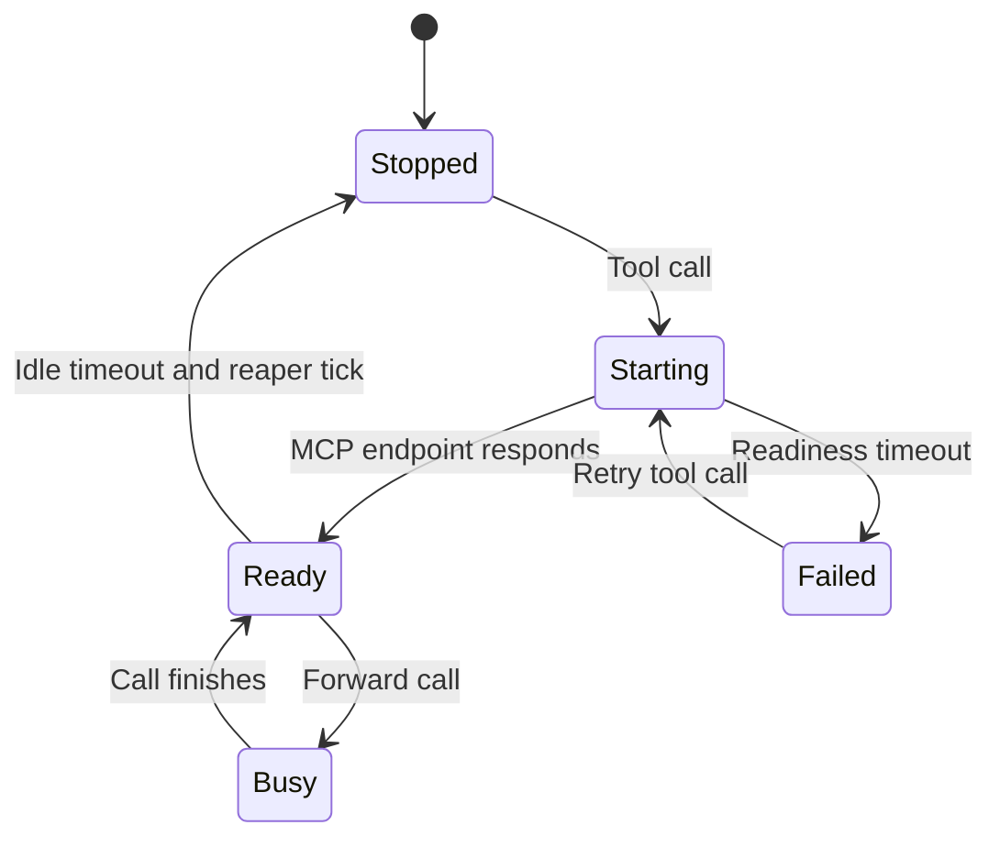

# On-Demand MCP Gateway

**One endpoint. Many tools. Backends that run only when you need them.**


A gateway for Docker-hosted MCP servers. It serves a cached tool catalog without
starting every backend, wakes the appropriate container for a tool call, and
stops idle backends. Useful for small home servers and development machines
where keeping every integration running wastes memory.

This repository contains generic examples, not a real deployment inventory.
No measured memory savings or performance guarantees are claimed.

## How it works





A startup timeout returns an error; it does not automatically stop the container.
Only containers listed in your manifest are managed.

## Quick start: working echo demo

Requires Docker Engine and Docker Compose v2 on a Linux host. The gateway
needs permission to access the Docker socket.

```sh
git clone https://github.com/gil906/MCP-On-Demand-Gateway.git
cd MCP-On-Demand-Gateway
cp manifest.example.json manifest.json
umask 077
python3 -c 'import secrets; print("GATEWAY_TOKEN=" + secrets.token_urlsafe(32))' > .env
docker compose up -d --build
docker compose stop demo
```

The token is generated into an ignored, owner-only file; it is not printed.
Do not commit or share `.env`.

Connect your MCP client to **`http://127.0.0.1:8121/mcp`**, using Streamable HTTP,
and configure an `Authorization: Bearer YOUR_LOCAL_TOKEN` header with the value
from your local `.env`. The gateway also accepts `X-API-Key`.
Header configuration syntax depends on the client.

Discover tools: **`demo_echo`** appears even while the demo is stopped.
Call it with:

```json
{"message": "Hello from an on-demand backend"}
```

The demo container starts automatically and returns the same message.
By default, the reaper stops it after about **10 minutes of inactivity**, plus
up to one reaper interval. Inspect status without displaying the token:

```sh
docker compose ps -a
docker compose logs --tail 30 gateway
```

Stop the example deployment with `docker compose down`.
The demo name `mcp-gateway-demo` must not conflict with an existing container.

## Add your own backend

Create its container first; the gateway starts existing containers, not images.
Place the backend on a network reachable by the gateway, and use a URL pointing
to its Streamable HTTP MCP endpoint. Do not use `localhost` for a different
container: it would refer to the gateway itself.

Each manifest entry consists of:

| Field | Meaning |
|-------|---------|
| Entry name, such as `demo` | Namespace; `echo` becomes `demo_echo` |
| `url` | Reachable backend MCP endpoint |
| `container` | Exact existing Docker container name |
| `tools` | Cached tool names, descriptions, input schemas, optional output schemas |

Copy `backends.example.json` to `backends.json` and adapt it locally. Start
**all listed backends** before capturing schemas. For the included demo:

```sh
cp backends.example.json backends.json
docker compose start demo
docker compose run --rm --no-deps \
  -v "$PWD/backends.json:/app/backends.json:ro" \
  -v "$PWD:/out" \
  gateway python capture.py --config /app/backends.json --output /out/manifest.json
docker compose restart gateway
```

Capture fails if any backend cannot be read and does not overwrite the existing
manifest in that case. Restart the gateway after changing the manifest.
Backend authentication is not implemented; use trusted, isolated backend
networks. Tool descriptions and schemas from backends should also be trusted.

> [!WARNING]
> Only list disposable MCP wrapper containers. The reaper stops listed containers,
> so do not point it at a database, media service, or other essential service.
> Avoid automatic `always` restart policies for these backend containers.

## Configuration

| Environment variable | Default | Purpose |
|----------------------|---------|---------|
| `GATEWAY_TOKEN` | Required at startup | Shared gateway bearer token / API key |
| `GATEWAY_HOST` | `127.0.0.1` | Direct-Python listen address; Compose overrides to `0.0.0.0` inside the container |
| `GATEWAY_PORT` | `8121` | HTTP port |
| `GATEWAY_PATH` | `/mcp` | MCP endpoint path |
| `GATEWAY_MANIFEST` | `manifest.json` beside the script | Cached backend/tool configuration |
| `GATEWAY_IDLE_TTL` | `600` | Idle seconds before a backend may be stopped |
| `GATEWAY_START_TIMEOUT` | `45` | Readiness wait budget, in seconds |
| `GATEWAY_REAP_INTERVAL` | `60` | Idle scan interval, in seconds |
| `DOCKER_SOCK` | `/var/run/docker.sock` | Docker Engine Unix socket |

To run without Docker, install Python 3.11, create a virtual environment, and
run `pip install -r requirements.txt`. Supply a local manifest and export
`GATEWAY_TOKEN`, then run `python gateway_ondemand.py`. Your Python user still
needs Docker socket access. Compose networking URLs such as `http://demo:8123/mcp`
must be replaced with addresses reachable from the host.

## Behavior and limits

Tool calls are serialized **per backend**, including startup and forwarding.
Different backends can run concurrently. The lifecycle lock prevents the idle
reaper from stopping a backend during a gateway-managed tool call. Usage outside
this gateway is not tracked.

There is no requests-per-second/minute quota, retry queue, or rate limiter.
Registry/API limits of your backend services still apply. Startup polling and
network overhead can extend the apparent startup timeout; client tool-call
timeouts also depend on the MCP client library.

The manifest is static: refresh it when backend tools change. The gateway uses
the local Docker Engine only; Kubernetes and remote Docker management are not
implemented.

## Security and privacy

> [!CAUTION]
> **Docker socket access is effectively host-administrator access.**
> Treat the gateway and its token as privileged infrastructure. A read-only socket
> filesystem mount does not make Docker API actions read-only.

The provided Compose file publishes only to loopback. For remote clients, use
TLS and an authenticated reverse proxy or VPN; never send the token over an
untrusted plaintext connection. Keep backend ports private.

`.env`, real backend/manifest files, logs, keys, and token files are excluded
from Git and Docker build context. These files may contain confidential tool
descriptions, addresses, or deployment details; review your own changes before
publishing them. Do not put credentials in backend URLs.

## Tests and troubleshooting

```sh
docker compose run --rm --no-deps \
  -v "$PWD/test_gateway.py:/app/test_gateway.py:ro" \
  gateway python -m unittest -v test_gateway
```

Tests mock Docker and backend calls; they do not start or stop real services.

| Problem | Check |
|---------|-------|
| `401 Unauthorized` | Client header matches the token in `.env` |
| Docker permission error | Socket exists and the gateway has access |
| Backend never becomes ready | Container exists, URL is reachable, transport is Streamable HTTP |
| Tools missing or schema changed | Recapture the manifest, then restart the gateway |
| Backend stops unexpectedly | Idle TTL, non-gateway traffic, and manifest container selection |
